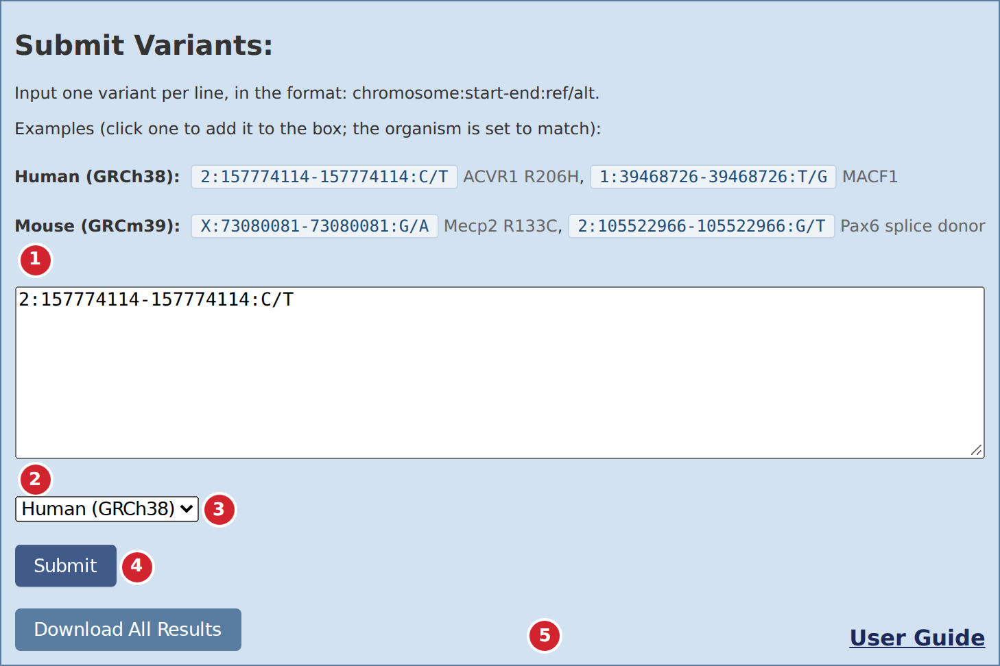
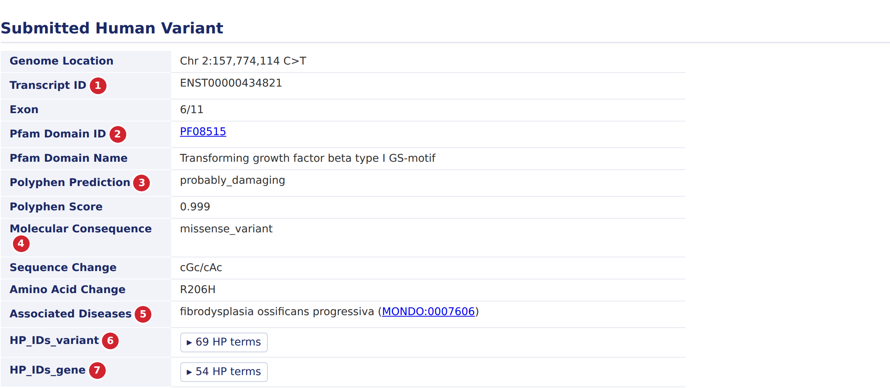
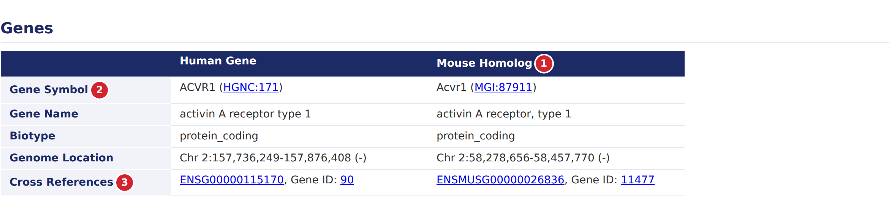
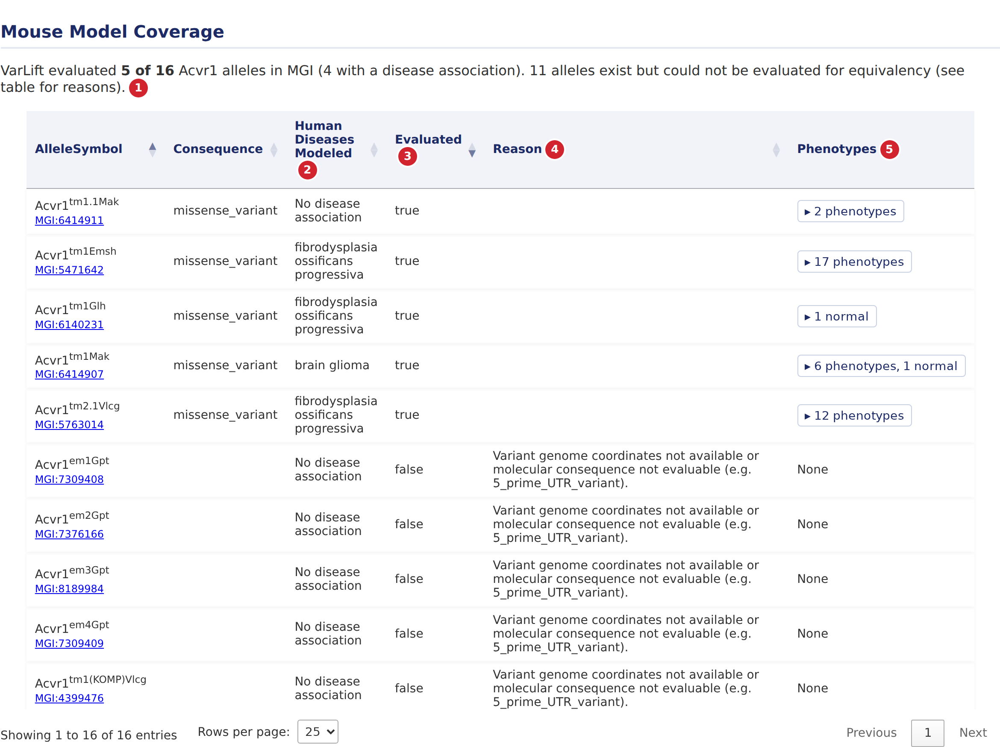
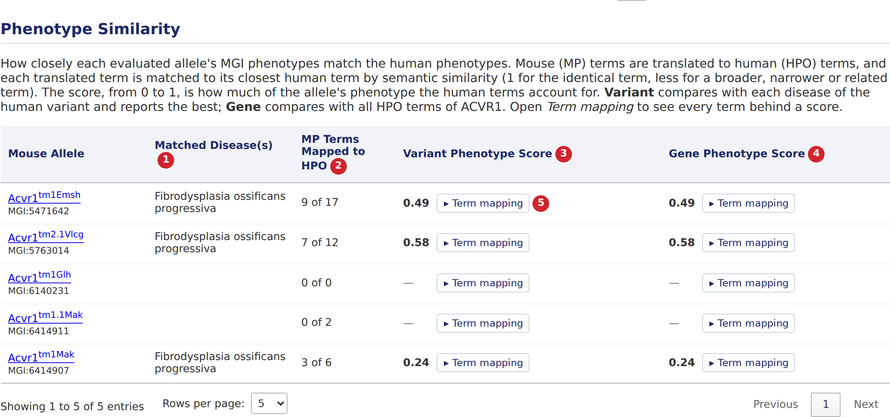
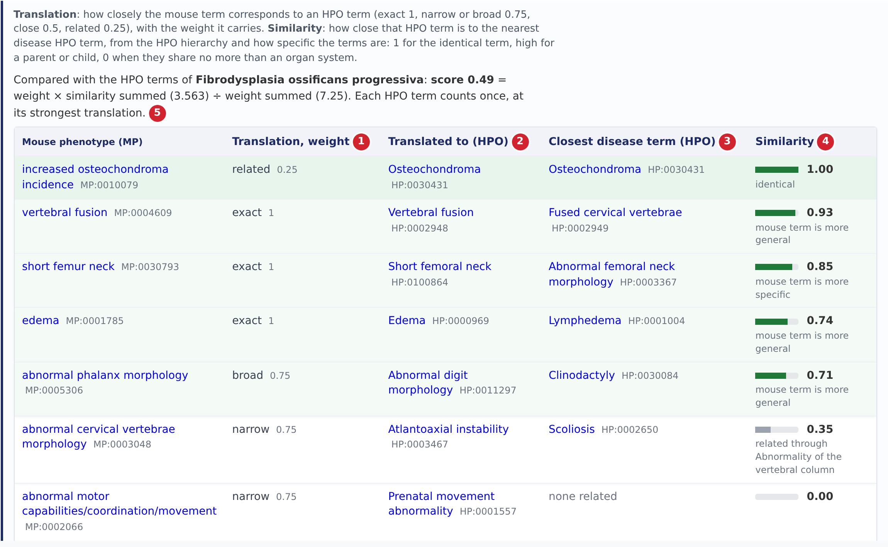

# VarLift User Guide

VarLift asks one question about a genetic variant: **is there an equivalent variant in the other species, and how closely does it match?**

Submit a human variant and VarLift finds the mouse alleles in the orthologous gene, scores how closely each one matches your variant at the sequence level, and scores how well each mouse model's phenotypes reproduce the human disease. Submit a mouse variant and VarLift finds human ClinVar variants that make the equivalent change in the orthologous human gene.

This guide explains how to submit variants, how each part of the results page is built, how the scores are calculated, and where the underlying data come from.

**Contents**

1. [Submitting variants](#1-submitting-variants)
2. [How a variant is analyzed](#2-how-a-variant-is-analyzed)
3. [Reading the results](#3-reading-the-results)
4. [How variant equivalence is scored](#4-how-variant-equivalence-is-scored)
5. [How phenotype similarity is scored](#5-how-phenotype-similarity-is-scored)
6. [Data sources and versions](#6-data-sources-and-versions)
7. [How often the data are updated](#7-how-often-the-data-are-updated)
8. [Limitations](#8-limitations)
9. [Glossary](#9-glossary)

---

## 1. Submitting variants

1. **Examples.** Click an example to place it in the box. The organism menu switches to match it. ACVR1 R206H (the classic fibrodysplasia ossificans progressiva variant) is a good first query.
2. **Variant box.** Enter one variant per line as `chromosome:start-end:ref/alt`, for example `2:157774114-157774114:C/T`. Use genomic coordinates on the forward strand. Omit the `chr` prefix.
3. **Organism.** Choose **Human (GRCh38)** or **Mouse (GRCm39)**. Coordinates must be on that assembly. VarLift does not convert GRCh37 or GRCm38 coordinates.
4. **Submit.** Starts the analysis.
5. **Download All Results.** Saves every table for every submitted variant as one JSON file.

While the query runs, a status panel shows **Assessing Variants…** and the elapsed time:

A single variant usually finishes in a few seconds to a minute. Genes with many mouse alleles take longer. When the query finishes, the panel lists your variants. Click a variant to see its results.

---

## 2. How a variant is analyzed

### Human variant submitted

| Step | What VarLift does | Data used |
|---|---|---|
| 1. Annotate | Ensembl VEP annotates the variant on the MANE Select transcript (the longest transcript when there is none). VEP reports the consequence, exon or intron number, Pfam domain, amino-acid change and PolyPhen prediction. | Ensembl VEP 116, GRCh38 cache |
| 2. Check that it can be scored | Coding, splice-site and intronic variants continue. UTR, non-coding-transcript and intergenic variants are reported as **not evaluated**, with the reason. | Sequence Ontology consequence terms |
| 3. Find the diseases | VarLift finds the variant's ClinVar records (exact position, reference and alternate allele) and converts their conditions to MONDO disease IDs. | ClinVar VCF and variant_summary, MONDO |
| 4. Collect human phenotypes | The variant's HPO terms come from ClinVar plus the HPO annotations of its diseases. The gene's HPO terms come from HPO's gene-to-phenotype file. | ClinVar, HPO annotations |
| 5. Find the mouse ortholog | VarLift looks up the human gene in MGI's human–mouse homology report. | MGI HOM_ProteinCoding.rpt |
| 6. Find the mouse alleles | VarLift collects every MGI allele of the mouse gene that has genomic coordinates, and annotates each one on every mouse transcript with VEP. | Alliance variant–allele file (MGI data), VEP GRCm39 cache |
| 7. Add mouse diseases and phenotypes | Each allele gets the diseases it models (Disease Ontology terms converted to MONDO) and its MGI phenotype (MP) annotations. | MGI disease-model and phenotype reports |
| 8. Score | Every allele/transcript pair is scored for **variant equivalence** (Section 4). Every allele is scored for **phenotype similarity** (Section 5). | — |

### Mouse variant submitted

| Step | What VarLift does |
|---|---|
| 1. Annotate | VEP annotates the variant on the canonical mouse transcript (GRCm39). |
| 2. Find the human ortholog | From MGI's homology report. |
| 3. Find candidate human variants | Coding variants are matched to ClinVar variants in the human gene with the **same amino-acid change** (for example, any R→C). Splice-site and intronic variants are matched to ClinVar SNVs at the **same intron offset** (for example, `+1`). Whether each candidate is at the equivalent position is then tested during scoring. |
| 4. Annotate and score | Each candidate human variant is annotated with VEP and scored for variant equivalence. |
| 5. Report | The page also lists the MGI alleles at exactly the submitted position, with their disease models and phenotypes. |

---

## 3. Reading the results

The screenshots below come from the human query **ACVR1 R206H** (`2:157774114-157774114:C/T`). For each variant, the page shows the sections in this order: Submitted Variant, Genes, Mouse Model Coverage, Mouse Variants Evaluated, Variant Equivalency Scoring and Phenotype Similarity.

### Submitted Human Variant

1. **Transcript ID**: the transcript VEP annotated. On human queries this is the MANE Select transcript.
2. **Pfam Domain**: the protein domain the variant falls in, if any. It links to InterPro.
3. **PolyPhen**: the predicted effect of a missense change. It is shown for reference and is not used in scoring.
4. **Molecular Consequence**: decides which set of scoring criteria applies (Section 4).
5. **Associated Diseases**: the variant's diseases from ClinVar, each followed by its linked MONDO ID.
6. **HP_IDs_variant**: HPO terms for this variant, from ClinVar and from the HPO annotations of its diseases. Click to list them.
7. **HP_IDs_gene**: every HPO term annotated to the gene. These are used for the gene-level phenotype score.

### Genes

1. The submitted gene and its ortholog, side by side.
2. **Gene Symbol** links to HGNC (human) or MGI (mouse).
3. **Cross References** gives the Ensembl gene ID and the NCBI Gene ID, each linked to its database.

### Mouse Model Coverage

This section shows how many of the gene's mouse alleles VarLift could assess, and why the rest could not be assessed.

1. **Summary.** How many of the gene's MGI alleles were evaluated, and how many of those have a disease association.
2. **Human Diseases Modeled.** The diseases MGI curates the allele as a model of. "No disease association" means MGI does not list the allele as a disease model. VarLift still scores it.
3. **Evaluated.** `true` means VarLift scored the allele. Evaluated alleles are listed first.
4. **Reason.** Why an allele was not evaluated. Usually the allele has no genomic coordinates in MGI (for example, many knockouts, gene traps and transgenes), or its consequence cannot be scored (for example, a 5′ UTR change).
5. **Phenotypes.** Click to list the allele's MGI phenotypes. "Normal" annotations (see Section 5) are counted separately.

### Mouse Variants Evaluated

1. **AlleleID.** Links to the MGI allele page.
2. **Transcript ID.** Each allele is listed once per mouse transcript, so one allele can have several rows.
3. **Amino Acid Change.** The change on that transcript. Residue numbers can differ between transcripts and between species. For example, Acvr1 tm1Emsh is R206H on most transcripts but R176H on ENSMUST00000469963.
4. **Associated Diseases.** The allele's disease models, with their MONDO IDs.

### Variant Equivalency Scoring

1. **Scoring Class.** Coding or Splice/Intronic. The class decides which criteria apply.
2. **Match columns.** `true` or `false` for each criterion. `null` means the criterion does not apply, or neither variant has a value for it. Null criteria are left out of the Total Score.
3. **Aligned Position.** The mouse residue that aligns with the human residue in a protein alignment. Here human R206 aligns with residue 176 on the shorter transcript, so **AA Position Match** is still `true`.
4. **Disease Match** (human queries only). `true` when the allele models at least one of the human variant's diseases (same MONDO ID).
5. **Total Score.** The percentage of applicable criteria that match (Section 4).

Rows are grouped by allele. Alleles are ordered by their best-scoring transcript, and transcripts within an allele are ordered by Total Score. The Phenotype Similarity table lists alleles in the same order.

### Phenotype Similarity (human queries)

1. **Matched Disease(s).** The human disease whose phenotypes best match the allele. When several diseases tie, all of them are listed, separated by semicolons.
2. **MP Terms Mapped to HPO.** How many of the allele's scored MP terms have a translation to HPO, for example "9 of 17". A low ratio means much of the mouse phenotype cannot be compared.
3. **Variant Phenotype Score.** Similarity to the phenotypes of the variant's own disease(s), from 0 to 1.
4. **Gene Phenotype Score.** Similarity to every phenotype annotated to the human gene, from 0 to 1.
5. **Term mapping.** Opens the term-by-term breakdown behind a score.

A dash (—) means the allele has no translatable phenotypes, so no score is possible. It does not mean a score of zero.

#### The term mapping panel

Each row follows one mouse phenotype through the calculation:

1. **Translation, weight.** How the MP term maps to HPO (exact, narrow, broad, close or related) and the weight that mapping carries.
2. **Translated to (HPO).** The HPO term the mouse phenotype becomes.
3. **Closest disease term (HPO).** The human disease term that is most similar to it.
4. **Similarity.** The similarity between the two terms, from 0 (unrelated, or related only through a broad organ-system category) to 1 (identical). The note underneath says how the terms are related, for example "mouse term is more general".
5. **The arithmetic.** The score is the sum of weight × similarity divided by the sum of weights. In this example, 3.563 ÷ 7.25 = **0.49**.

Rows shaded green have a similarity of 0.5 or more (darker for identical terms). The panel also lists MP terms that have no HPO translation, terms that are not scored, and "normal" annotations.

### Mouse queries

For a submitted mouse variant, the page shows **Human Variants Evaluated** (the candidate ClinVar variants) and scores each one. Disease Match and Phenotype Similarity are not calculated. The page instead shows **Human Phenotypes** and the Mouse Model Coverage of the submitted gene.

The example below is a Pax6 splice-donor variant (`2:105522966-105522966:G/T`). It shows the Splice/Intronic scoring class:

1. **Scoring Class** is Splice/Intronic, so the coding criteria are not shown.
2. **Intron Match** is `false`: the human variants lie in a different-numbered intron from the mouse variant.
3. **Intron Offset Match** is `true`: every candidate is at the same position relative to the exon (`+1`, the first intronic base).
4. **Total Score** is 75: three of the four applicable criteria match.

---

## 4. How variant equivalence is scored

The equivalence score measures **how closely two variants make the same molecular change**. It compares annotations; it does not predict pathogenicity.

### Scoring classes

A variant's VEP consequence puts it in one of two classes. Each class has its own criteria.

| Criterion | Coding | Splice/Intronic | Matches when… |
|---|:-:|:-:|---|
| Biotype Match | ✓ | ✓ | both transcripts have the same biotype (for example, protein_coding) |
| Consequence Match | ✓ | ✓ | both variants have the same VEP consequence |
| AA Match | ✓ | | the reference and variant amino acids are the same (for example, R/H and R/H) |
| AA Position Match | ✓ | | the residues are at equivalent positions in a protein alignment of the two transcripts |
| Exon Match | ✓ | | both are in the same-numbered exon (for example, 6/11) |
| Domain Match | ✓ | | both are in the same Pfam domain |
| Intron Match | | ✓ | both are in the same-numbered intron |
| Intron Offset Match | | ✓ | both are the same distance from the exon boundary (HGVS style, for example +1 or −2) |
| Disease Match | ✓ | ✓ | the mouse allele models at least one of the human variant's diseases (human queries only) |

- **Coding** consequences include missense, synonymous, stop gained or lost, start lost, frameshift, and in-frame insertions and deletions.
- **Splice/Intronic** consequences include splice donor and acceptor, splice region, and intron variants.
- Other consequences (UTR, non-coding transcript, intergenic) are **not evaluated**.

### Total Score

**Total Score = matching criteria ÷ applicable criteria × 100**

A criterion is left out (shown as `null`) when it does not belong to the variant's class, or when neither variant has a value for it. For example, Domain Match is left out when neither variant is in a Pfam domain, and Disease Match is left out when the mouse allele has no disease model. A missing value therefore never counts against a score. A score of 100 means every applicable criterion matched.

### Aligned positions

Residue numbers are not directly comparable between orthologs or isoforms: one protein may have extra residues before the variant (as with the ACVR1 example in Section 3, where human R206 corresponds to residue 176 on one mouse transcript). VarLift therefore aligns the two protein sequences (global alignment, BLOSUM62) and checks whether the mouse residue is the one aligned to the human residue. Very long proteins (for example, titin) are aligned in a window around the variant.

### What the score does not do

- **Null alleles are not treated as matches for loss-of-function variants.** A knockout or null allele is not assumed to be equivalent to a human stop-gain or frameshift, because a null allele does not always produce the same loss of function.
- **PolyPhen is not used.** It is shown for reference only.
- The score is a percentage of criteria, not a probability. Compare scores within a query; do not read them as a measure of clinical confidence.

---

## 5. How phenotype similarity is scored

The phenotype score measures **how much of a mouse allele's phenotype is explained by the human phenotypes**. It is calculated for human queries, separately for every evaluated mouse allele.

### Step 1: Choose the mouse terms to score

VarLift starts with the allele's MGI Mammalian Phenotype (MP) annotations. Three kinds are left out:

- **Top-level system terms** (for example, "nervous system phenotype"). They translate to equally broad HPO terms that disease annotations almost never use.
- **"No abnormal phenotype detected"** (MP:0002169).
- **"Normal" annotations.** Here MGI recorded that a phenotype was examined and found normal. These are shown in the term mapping panel but never scored.

### Step 2: Translate mouse terms to HPO

Each MP term is translated to one or more HPO terms using MGI's curated MP–HPO mappings. Each translation has a weight that reflects how equivalent the two terms are:

| Mapping type (SKOS) | Meaning | Weight |
|---|---|---|
| exactMatch | same phenotype | 1.0 |
| narrowMatch | the HPO term is more specific than the MP term | 0.75 |
| broadMatch | the HPO term is more general than the MP term | 0.75 |
| closeMatch | nearly the same | 0.5 |
| relatedMatch | related, but not a parent or child | 0.25 |

If several MP terms translate to the same HPO term, it counts once, at its highest weight. A few mappings point to HPO terms that HPO has since retired. Each of these was reviewed: it is either redirected to the current term, or dropped where the current term would change the meaning.

### Step 3: Find the closest human term

Each translated HPO term is compared with every term in the human reference set and paired with the **most similar** one. Similarity is measured with the **Lin semantic similarity** on the HPO hierarchy, an approach similar to Monarch's Phenodigm:

- **Information content (IC)** of a term = −log(the share of HPO-annotated diseases that have the term or one of its descendants). Rare, specific terms have high IC.
- **Similarity** = 2 × IC(most informative shared ancestor) ÷ (IC(term A) + IC(term B)).

Identical terms score 1. A parent and child score high. Terms that share only a top-level category or an organ system (for example, "Abnormality of the skeletal system") score 0, because sharing an organ system is not phenotypic similarity.

### Step 4: Combine into a score

**Score = Σ (weight × similarity) ÷ Σ weight**, summed over the allele's translated HPO terms.

The score runs from 0 to 1. It is **asymmetric**: it asks how much of the mouse phenotype the human terms account for, not how much of the human disease the mouse reproduces. A disease with many HPO terms is therefore not penalized for features the mouse was never examined for. The mouse terms that have no HPO translation are reported in **MP Terms Mapped to HPO** rather than lowering the score.

### Variant score and gene score

- **Variant Phenotype Score.** The human reference set is the HPO annotation of **each of the variant's diseases, one disease at a time**. The highest score is reported, with the disease(s) that reached it. Tied diseases are all listed, because no single disease is the better match.
- **Gene Phenotype Score.** The human reference set is **every HPO term annotated to the human gene**, across all its diseases. A gene score well above the variant score suggests the mouse model resembles a different disease of the same gene.

### Worked example

Acvr1 tm1Emsh (an R206H knock-in) compared with fibrodysplasia ossificans progressiva:

| Mouse phenotype | Weight | Closest FOP term | Similarity | Weight × similarity |
|---|---|---|---|---|
| increased osteochondroma incidence | 0.25 (related) | Osteochondroma | 1.00 | 0.25 |
| vertebral fusion | 1 (exact) | Fused cervical vertebrae | 0.93 | 0.93 |
| short femur neck | 1 (exact) | Abnormal femoral neck morphology | 0.85 | 0.85 |
| … | | | | |
| **Totals** | **7.25** | | | **3.563** |

Score = 3.563 ÷ 7.25 = **0.49**. In other words, about half of the mouse phenotype, weighted by translation confidence, is accounted for by FOP's clinical features.

---

## 6. Data sources and versions

VarLift runs on local copies of the following resources. The versions below are the ones the current installation uses.

| Resource | Used for | Version or release | Copy taken |
|---|---|---|---|
| **Ensembl VEP** and VEP cache | Annotating human and mouse variants | Release 116 (GRCh38, GRCm39) | — |
| **Ensembl** gene annotation (GFF3) and protein sequences | Gene details, exon boundaries for intron offsets, protein alignments | Release 116 | 2026-10-23 to 2026-11-06 |
| **ClinVar** VCF (GRCh38) | The submitted variant's diseases | File date 2026-10-19 | 2026-10-23 |
| **ClinVar** variant_summary | More diseases and HPO terms; candidate human variants for mouse queries | Weekly file | 2026-10-23 |
| **MGI** HOM_ProteinCoding.rpt | Human–mouse orthologs; NCBI Gene IDs | — | 2026-10-27 |
| **MGI** MGI_DiseaseMouseModel.rpt | Diseases each mouse allele models; the coverage table | — | 2026-10-27 |
| **MGI** ALL_Phenotype.rpt | Phenotypes of each allele | — | 2026-10-27 |
| **MGI** MGI_PhenoGenoMP.rpt | Telling abnormal from "normal" phenotype annotations | — | 2026-11-10 |
| **Alliance of Genome Resources** variant–allele file (mouse, from MGI) | Genomic coordinates of MGI alleles | Alliance 9.0.0 (file generated 2026-04-05) | 2026-10-27 |
| **Mammalian Phenotype Ontology** (MP) | Identifying top-level MP terms | Release 2026-10-29 | 2026-11-10 |
| **Human Phenotype Ontology** (hp.obo) | Term names, hierarchy and similarity | Release 2026-09-01 | 2026-11-10 |
| **HPO annotations** (phenotype.hpoa, genes_to_phenotype.txt) | HPO terms of diseases and genes; information content | Release 2026-09-01 | 2026-10-28 |
| **MP–HPO mappings** (MGI, via the Mouse-Human Mapping Initiative, SSSOM) | Translating mouse phenotypes to HPO | 1,564 mappings; latest curated 2026-06-23 | 2026-10-27 |
| **MONDO** disease ontology | Disease names; converting OMIM, Orphanet and Disease Ontology IDs to MONDO | — | 2026-10-27 |
| **InterPro** (Pfam entries) | Pfam domain names | — | 2026-11-09 |

Download locations for each resource are listed in `app/config.yaml`.

---

## 7. How often the data are updated

VarLift's data are **not updated automatically**. The local copies are refreshed by the VarLift maintainers with the refresh script (`app/data_refresh.py`), which downloads the current files and rebuilds VarLift's lookup tables. The "Copy taken" dates in Section 6 show the current snapshot. Results can differ from the live MGI, ClinVar or HPO websites when those resources have changed since the last refresh.

How often the source resources themselves are released (approximate):

| Resource | Typical release schedule |
|---|---|
| ClinVar | Weekly updates; monthly full releases |
| MGI reports | Updated regularly as curation is added (weekly) |
| Alliance of Genome Resources | A few releases a year |
| HPO and its annotations | About monthly |
| MP ontology | About monthly |
| MONDO | Monthly |
| Ensembl and VEP | A few releases a year (the VEP cache must match the release) |

---

## 8. Limitations

- **Assemblies.** Human coordinates must be GRCh38 and mouse coordinates GRCm39.
- **Variant types.** Only coding, splice-site and intronic variants are scored. Other variants are reported as not evaluated.
- **Mouse alleles without coordinates.** Many knockouts, gene traps and transgenes have no genomic coordinates in MGI, so they cannot be scored. They still appear in the Mouse Model Coverage table with the reason.
- **One-to-one orthologs.** Orthologs come from MGI's protein-coding homology report. Genes without a human–mouse ortholog there cannot be mapped.
- **Disease Match uses exact MONDO IDs.** A mouse model of a closely related disease (a parent or child term in MONDO) does not count as a match.
- **Phenotype coverage depends on the MP–HPO mappings.** MP terms without a curated HPO mapping cannot contribute. Check **MP Terms Mapped to HPO** before reading a low score as a poor model.
- **Phenotypes are scored per allele.** MGI phenotypes are annotated to genotypes. VarLift pools all genotypes that carry an allele, including different genetic backgrounds and zygosities.
- **This is a research tool.** It is under active development. Confirm results against the primary resources before relying on them.

---

## 9. Glossary

| Term | Meaning |
|---|---|
| **Allele (MGI)** | A specific mouse gene variant in MGI, for example Acvr1tm1Emsh. It may be engineered or spontaneous. |
| **Canonical / MANE Select transcript** | The transcript chosen to represent a gene. MANE Select is the human transcript agreed between Ensembl and NCBI. |
| **HPO** | Human Phenotype Ontology: standard terms for human clinical features. |
| **Information content (IC)** | How specific an ontology term is. Rarely used terms have high IC. |
| **Lin similarity** | A measure of how alike two ontology terms are, from 0 to 1, based on their most informative shared ancestor. |
| **MONDO** | Mondo Disease Ontology. It unifies disease IDs from OMIM, Orphanet, the Disease Ontology and others. |
| **MP** | Mammalian Phenotype Ontology: standard terms for mouse phenotypes, used by MGI. |
| **Ortholog** | The corresponding gene in another species, descended from a common ancestral gene. |
| **Pfam domain** | A conserved protein domain family, as classified by Pfam/InterPro. |
| **SKOS mapping** | A standard way to describe how two terms relate: exact, narrow, broad, close or related match. |
| **SSSOM** | Simple Standard for Sharing Ontological Mappings: the file format of the MP–HPO mappings. |
| **VEP** | Ensembl Variant Effect Predictor. It annotates a variant's consequences on genes and transcripts. |
