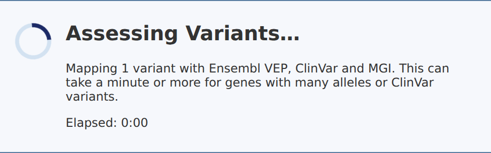
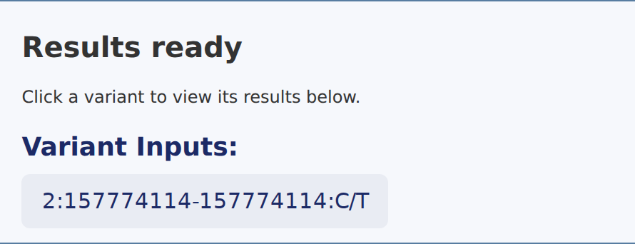
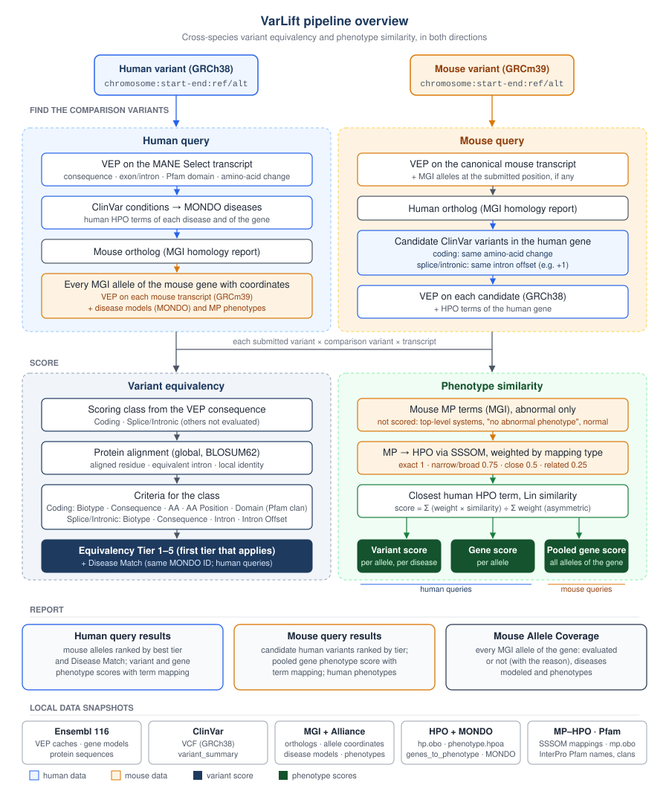
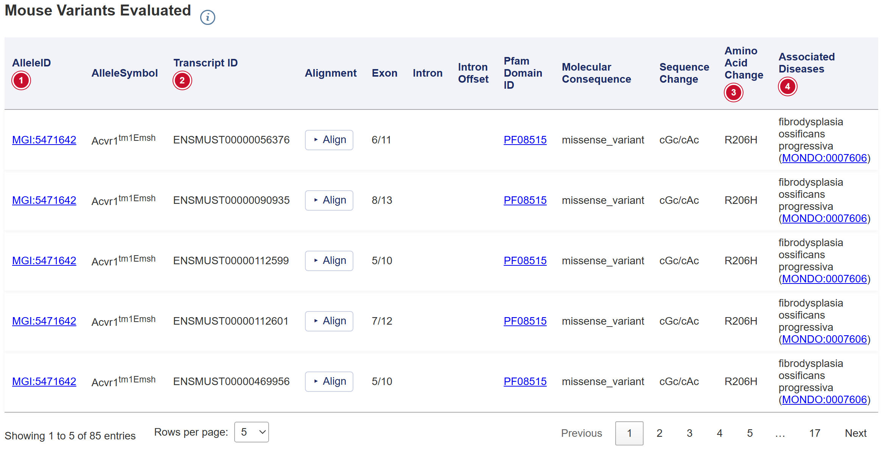
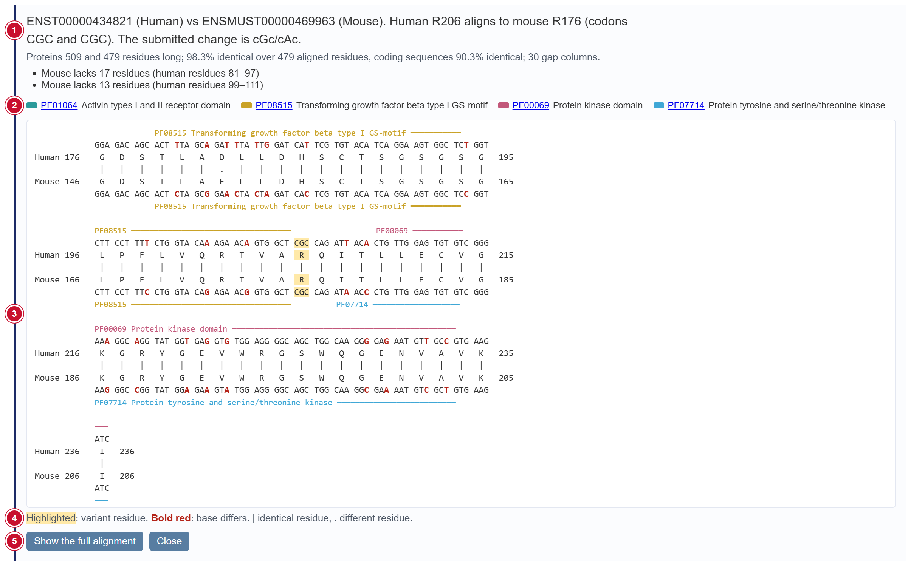
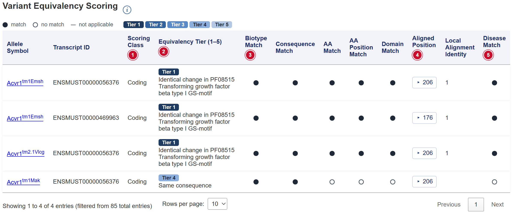
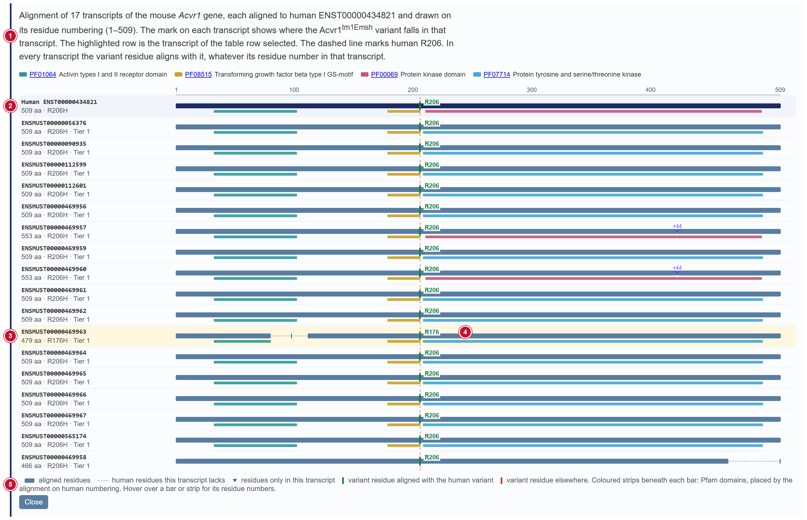
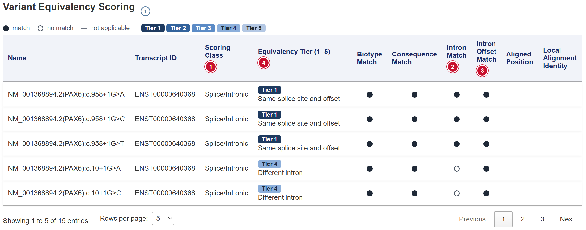
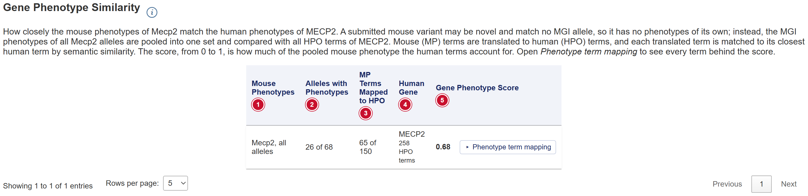

# VarLift User Guide

VarLift asks one question about a genetic variant: **is there an equivalent variant in the other species, and how closely does it match?**

Submit a human variant and VarLift finds the mouse alleles in the orthologous gene, scores how closely each one matches your variant at the sequence level, and scores how well each mouse model's phenotypes reproduce the human disease. Submit a mouse variant and VarLift finds human ClinVar variants that make the equivalent change in the orthologous human gene, and scores how well the mouse gene's known phenotypes, pooled across all its alleles, match the human gene's.

This guide explains how to submit variants, how each part of the results page is built, how the scores are calculated, and where the underlying data come from.

**Contents**

1. [Submitting variants](#1-submitting-variants)
2. [How a variant is analyzed](#2-how-a-variant-is-analyzed)
3. [Reading the results](#3-reading-the-results)
4. [How variant equivalence is scored](#4-how-variant-equivalence-is-scored)
5. [How phenotype similarity is scored](#5-how-phenotype-similarity-is-scored)
6. [Data sources and versions](#6-data-sources-and-versions)
7. [How often the data are updated](#7-how-often-the-data-are-updated)
8. [Limitations](#8-limitations)
9. [Glossary](#9-glossary)

---

## 1. Submitting variants

1. **Examples.** Click an example to place it in the box. The organism menu switches to match it. ACVR1 R206H (the classic fibrodysplasia ossificans progressiva variant) is a good first query.
2. **Variant box.** Enter one variant per line as `chromosome:start-end:ref/alt`, for example `2:157774114-157774114:C/T`. Use genomic coordinates on the forward strand. Omit the `chr` prefix. To label a variant, add a tab (or spaces) and the label after it, for example `X:73079562-73079562:G/A<tab>Mecp2<tm5.1Bird>`. The label is shown beside the variant in the Variant Inputs list and as the first field of the Submitted Variant table; it is not used in the analysis. Variants entered more than once with different labels show all their labels, separated by semicolons.
3. **Organism.** Choose **Human (GRCh38)** or **Mouse (GRCm39)**. Coordinates must be on that assembly. VarLift does not convert GRCh37 or GRCm38 coordinates.
4. **Submit.** Starts the analysis. **Clear** empties the variant box; results already on screen stay until the next submission.
5. **Download All Results.** Saves every table for every submitted variant as one JSON file, together with the organism and the variants as entered. The file is named by when the results were produced, for example `VarLift_results_2026-11-13_0915.json`.
6. **Load Results.** Reopens a file saved with Download All Results, so you can browse it exactly as when it ran. The organism and the variant box are set back to what was submitted. To keep one set of results while running another, download it first and load it again later, or run the new set in a second browser tab.

While the query runs, a status panel shows **Assessing Variants…** and the elapsed time:

A single variant usually finishes in a few seconds to a minute. Genes with many mouse alleles take longer. When the query finishes, the panel lists your variants. Click a variant to see its results.

---

## 2. How a variant is analyzed

The figure shows both directions. The comparison variants differ (mouse alleles for a human query, candidate ClinVar variants for a mouse query), but every pair is scored the same way for variant equivalence. Phenotype similarity is scored per mouse allele for a human query, and once per gene for a mouse query. The tables below give the steps in detail.

### Human variant submitted

| Step | What VarLift does | Data used |
|---|---|---|
| 1. Annotate | Ensembl VEP annotates the variant on the MANE Select transcript (the longest transcript when there is none). VEP reports the consequence, exon or intron number, Pfam domain, amino-acid change and PolyPhen prediction. | Ensembl VEP 116, GRCh38 cache |
| 2. Check that it can be scored | Coding, splice-site and intronic variants continue. UTR, non-coding-transcript and intergenic variants are reported as **not evaluated**, with the reason. | Sequence Ontology consequence terms |
| 3. Find the diseases | VarLift finds the variant's ClinVar records (exact position, reference and alternate allele) and converts their conditions to MONDO disease IDs. | ClinVar VCF and variant_summary, MONDO |
| 4. Collect human phenotypes | The variant's HPO terms come from ClinVar plus the HPO annotations of its diseases. The gene's HPO terms come from HPO's gene-to-phenotype file. | ClinVar, HPO annotations |
| 5. Find the mouse ortholog | VarLift looks up the human gene in MGI's human–mouse homology report. | MGI HOM_ProteinCoding.rpt |
| 6. Find the mouse alleles | VarLift collects every MGI allele of the mouse gene that has genomic coordinates, and annotates each one on every mouse transcript with VEP. | Alliance variant–allele file (MGI data), VEP GRCm39 cache |
| 7. Add mouse diseases and phenotypes | Each allele gets the diseases it models (Disease Ontology terms converted to MONDO) and its MGI phenotype (MP) annotations. | MGI disease-model and phenotype reports |
| 8. Score | Every allele/transcript pair is scored for **variant equivalence** (Section 4). Every allele is scored for **phenotype similarity** (Section 5). | — |

### Mouse variant submitted

| Step | What VarLift does |
|---|---|
| 1. Annotate | VEP annotates the variant on the canonical mouse transcript (GRCm39). |
| 2. Find the human ortholog | From MGI's homology report. |
| 3. Find candidate human variants | Coding variants are matched to ClinVar variants in the human gene with the **same amino-acid change** (for example, any R→C). Splice-site and intronic variants are matched to ClinVar SNVs at the **same intron offset** (for example, `+1`). Whether each candidate is at the equivalent position is then tested during scoring. |
| 4. Annotate and score | Each candidate human variant is annotated with VEP and scored for variant equivalence. |
| 5. Score gene phenotypes | The MGI phenotypes of all the mouse gene's alleles are pooled into one set and scored against the HPO terms of the human gene (Section 5). The submitted variant may be novel and match no MGI allele, so it has no phenotypes of its own. |
| 6. Report | The page also lists every MGI allele of the mouse gene in Mouse Allele Coverage, marking the alleles at exactly the submitted position, with their disease models and phenotypes. |

---

## 3. Reading the results

Every results table has an **i** button beside its heading. Click it for a short explanation of the table and its columns (for Variant Equivalency Scoring, also the tiers). Close it with the × button, the Escape key, or a click outside it.

The screenshots below come from the human query **ACVR1 R206H** (`2:157774114-157774114:C/T`). For each variant, the page shows the sections in this order: Submitted Variant, Genes, Mouse Allele Coverage, Mouse Variants Evaluated, Variant Equivalency Scoring and Phenotype Similarity.

### Submitted Human Variant

1. **Transcript ID**: the transcript VEP annotated. On human queries this is the MANE Select transcript.
2. **Pfam Domain**: the protein domain the variant falls in, if any. It links to InterPro.
3. **PolyPhen**: the predicted effect of a missense change. It is shown for reference and is not used in scoring.
4. **Molecular Consequence**: decides which set of scoring criteria applies (Section 4).
5. **Associated Conditions**: the variant's conditions from ClinVar, each followed by its linked MONDO ID.
6. **HP_IDs_variant**: HPO terms for this variant, from ClinVar and from the HPO annotations of its diseases. Click to list them.
7. **HP_IDs_gene**: every HPO term annotated to the gene. These are used for the gene-level phenotype score.

### Genes

1. The submitted gene and its ortholog, side by side.
2. **Gene Symbol** links to HGNC (human) or MGI (mouse).
3. **Cross References** gives the Ensembl gene ID and the NCBI Gene ID, each linked to its database.

### Mouse Allele Coverage

This section shows how many of the gene's mouse alleles VarLift could assess, and why the rest could not be assessed.

1. **Summary.** How many of the gene's MGI alleles were evaluated, and how many of those have a disease association.
2. **Human Diseases Modeled.** The diseases MGI curates the allele as a model of. "No disease association" means MGI does not list the allele as a disease model. VarLift still scores it.
3. **Evaluated.** `true` means VarLift scored the allele. Evaluated alleles are listed first.
4. **Reason.** Click `false` under Evaluated to see why an allele was not evaluated. Usually the allele has no genomic coordinates in MGI (for example, many knockouts, gene traps and transgenes), or its consequence cannot be scored (for example, a 5′ UTR change).
5. **Phenotypes.** Click to list the allele's MGI phenotypes. "Normal" annotations (see Section 5) are counted separately.

### Mouse Variants Evaluated

1. **AlleleID.** Links to the MGI allele page.
2. **Transcript ID.** Each allele is listed once per mouse transcript, so one allele can have several rows.
3. **Amino Acid Change.** The change on that transcript. Residue numbers can differ between transcripts and between species. For example, Acvr1 tm1Emsh is R206H on most transcripts but R176H on ENSMUST00000469963.
4. **Associated Diseases.** The allele's disease models, with their MONDO IDs.

#### The alignment panel (Align)

**Align**, beside each Transcript ID, opens a codon-level alignment of the submitted variant's transcript and that row's transcript beneath the row. The example is Acvr1 tm1Emsh on ENSMUST00000469963, a shorter transcript:

1. **Summary.** Which residue the submitted residue aligns to (here human R206 to mouse R176) and both codons, then the length and identity of the two proteins and any stretch one of them lacks (this transcript lacks 30 residues of the extracellular domain).
2. **Pfam domains.** One colour per domain, linked to InterPro. Domain lines above and below the sequences show where each protein's domains lie.
3. **The alignment.** For each block of 20 residues: the human codons and residues, a line marking identical (`|`) and different (`.`) residues, then the mouse residues and codons. Bases that differ between the codons are bold red, and the variant residue is highlighted.
4. **Key** to the highlighting and marks.
5. **Show the full alignment.** At first only the 30 residues either side of the variant are shown; this shows the whole protein (and **Show the region around the variant** goes back). **Close** closes the panel, as does clicking **Align** again.

### Variant Equivalency Scoring

1. **Scoring Class.** Coding or Splice/Intronic. The class decides which criteria apply.
2. **Equivalency Tier (1–5).** How equivalent the two variants are, from Tier 1 (identical change) to Tier 5 (different consequence). The tier is a coloured chip on the first line and what it rests on (for example, "Same domain") is on the line below (Section 4). A transcript that is not protein-coding (for example, a nonsense-mediated decay transcript) is marked "not used for the allele's tier".
3. **Match columns.** A filled circle (match) or an open circle (no match) for each criterion, the evidence behind the tier. A dash means the criterion does not apply, or neither variant has a value for it. A key above the table shows the circles and the tier colours (Tier 1 darkest). In the downloaded results these values are `true`, `false` and `null`.
4. **Aligned Position.** The mouse residue that aligns with the human residue in a protein alignment. Here human R206 aligns with residue 176 on the shorter transcript, so **AA Position Match** is still `true`. Click it to see all the gene's transcripts aligned.
   **Local Alignment Identity** is the fraction of the 10 residues on each side that align to identical residues. Below 0.3, about what unrelated proteins give, the aligned position is uncertain.
5. **Disease Match** (human queries only). `true` when the allele models at least one of the human variant's conditions (same MONDO ID). It is shown beside the tier, not combined with it.

The screenshot shows four of the 85 rows: tm1Emsh on two transcripts, another R206H knock-in (tm2.1Vlcg), and tm1Mak, a G328V allele. tm1Mak shares the biotype and consequence but not the amino-acid change, the residue or the domain, so it is Tier 4 with open circles for those criteria.

Rows are grouped by allele. Alleles are ordered by their best tier on a protein-coding transcript, then by Disease Match; transcripts within an allele are ordered by tier. The Phenotype Similarity table lists alleles in the same order.

#### All transcripts aligned (Aligned Position)

Clicking a number under **Aligned Position** opens an overview of every transcript scored for that allele, each aligned to the submitted variant's transcript. It shows at a glance whether the variant falls at the equivalent residue in all of them. The example was opened from tm1Emsh on ENSMUST00000469963:

1. **Summary.** How many transcripts are shown and whether the variant residue aligns with the submitted residue in every one of them.
2. **Reference.** The human transcript. Every bar below is drawn on its residue numbering (here 1–509), and the dashed line marks the submitted residue, R206.
3. **The selected transcript**, highlighted. Solid bar: residues that align to the human protein. Dashed line: human residues this transcript lacks (here 30 residues near the start). Coloured strips beneath each bar are Pfam domains, and a purple mark (for example `+44`) shows residues found only in that transcript.
4. **The variant mark.** Green when the transcript's variant residue aligns with the human variant, orange when it falls elsewhere. Here it is labelled R176 but sits on the dashed line: the same residue, numbered differently.
5. **Key** to the bars and marks. Hover over a bar or strip for its residue numbers.

### Phenotype Similarity (human queries)

1. **Matched Disease(s).** The human disease whose phenotypes best match the allele. When several diseases tie, all of them are listed, separated by semicolons.
2. **MP Terms Mapped to HPO.** How many of the allele's scored MP terms have a translation to HPO, for example "9 of 17". A low ratio means much of the mouse phenotype cannot be compared.
3. **Variant Phenotype Score.** Similarity to the phenotypes of the variant's own disease(s), from 0 to 1.
4. **Gene Phenotype Score.** Similarity to every phenotype annotated to the human gene, from 0 to 1.
5. **Phenotype term mapping.** Opens the term-by-term breakdown behind a score.

A dash (—) means the allele has no translatable phenotypes, so no score is possible. It does not mean a score of zero.

#### The term mapping panel

Each row follows one mouse phenotype through the calculation:

1. **Translation, weight.** How the MP term maps to HPO (exact, narrow, broad, close or related) and the weight that mapping carries.
2. **Translated to (HPO).** The HPO term the mouse phenotype becomes.
3. **Closest disease term (HPO).** The human disease term that is most similar to it.
4. **Similarity.** The similarity between the two terms, from 0 (unrelated, or related only through a broad organ-system category) to 1 (identical). The note underneath says how the terms are related, for example "mouse term is more general".
5. **The arithmetic.** The score is the sum of weight × similarity divided by the sum of weights. In this example, 3.563 ÷ 7.25 = **0.49**.

Rows shaded green have a similarity of 0.5 or more (darker for identical terms). The panel also lists MP terms that have no HPO translation, terms that are not scored, and "normal" annotations.

### Mouse queries

For a submitted mouse variant, the page shows **Human Variants Evaluated** (the candidate ClinVar variants) and scores each one. Disease Match and the per-allele Phenotype Similarity are not calculated. The page instead shows the Mouse Allele Coverage of the submitted gene, **Gene Phenotype Similarity**, and **Human Phenotypes**.

The example below is a Pax6 splice-donor variant (`2:105522966-105522966:G/T`). It shows the Splice/Intronic scoring class:

1. **Scoring Class** is Splice/Intronic, so the coding criteria are not shown.
2. **Intron Match** is `true` for c.958+1: the mouse variant is in intron 9 of its transcript and the human variant in intron 11 of the human transcript, but both introns split the coding sequence at the same aligned residue, so they are the same intron.
3. **Intron Offset Match** is `true`: the candidates are at the same position relative to the exon (`+1`, the first intronic base).
4. **Equivalency Tier** is 1 (same splice site and offset) for the c.958+1 variants and 4 (different intron) for +1 variants in other introns.

#### Gene Phenotype Similarity (mouse queries)

A submitted mouse variant may be novel, so it may match no MGI allele and have no phenotypes of its own. VarLift therefore compares phenotypes at the gene level: the MGI phenotypes of every allele of the mouse gene are pooled into one set and compared with all HPO terms of the human gene. The table has one row:

1. **Mouse Phenotypes.** The pooled phenotypes of the mouse gene, for example "Mecp2, all alleles".
2. **Alleles with Phenotypes.** How many of the gene's MGI alleles have phenotype annotations, of all its alleles in Mouse Allele Coverage (for Mecp2, 26 of 68).
3. **MP Terms Mapped to HPO.** How many of the pooled, scored MP terms have a translation to HPO (for Mecp2, 65 of 150).
4. **Human Gene.** The human gene whose HPO terms are the reference, with how many terms it has.
5. **Gene Phenotype Score.** The similarity of the pooled mouse phenotypes to the human gene, from 0 to 1 (Mecp2 against MECP2: 0.68). **Phenotype term mapping** opens the term-by-term breakdown, as for human queries.

A dash (—) means no score is possible: none of the pooled phenotypes can be translated, or the human gene has no HPO annotations (for example, ADAMTS20). The score describes the gene, not the submitted variant, and is the same for every variant in the gene.

---

## 4. How variant equivalence is scored

The equivalency tier measures **how closely two variants make the same molecular change**. It compares annotations; it does not predict pathogenicity.

### Scoring classes

A variant's VEP consequence puts it in one of two classes. Each class has its own criteria.

| Criterion | Coding | Splice/Intronic | Matches when… |
|---|:-:|:-:|---|
| Biotype Match | ✓ | ✓ | both transcripts have the same biotype (for example, protein_coding) |
| Consequence Match | ✓ | ✓ | the variants share a main VEP consequence term. Modifiers such as NMD_transcript_variant are ignored |
| AA Match | ✓ | | the reference and variant amino acids are the same (for example, R/H and R/H) |
| AA Position Match | ✓ | | the residues are at equivalent positions in a protein alignment of the two transcripts |
| Domain Match | ✓ | | the residues are in Pfam domains of the same Pfam clan (any domain at the residue, not only the first). Families outside a clan must be the same family |
| Intron Match | | ✓ | the introns are equivalent: they split the coding sequence at the same aligned residue, with the same codon phase. Introns outside the coding sequence are compared by number |
| Intron Offset Match | | ✓ | both are the same distance from the exon boundary (HGVS style, for example +1 or −2) |
| Disease Match | ✓ | ✓ | the mouse allele models at least one of the human variant's conditions (human queries only). Shown beside the tier, not part of it |

- **Coding** consequences include missense, synonymous, stop gained or lost, start lost, frameshift, and in-frame insertions and deletions.
- **Splice/Intronic** consequences include splice donor and acceptor, splice region, and intron variants.
- Other consequences (UTR, non-coding transcript, intergenic) are **not evaluated**.
- **Exon number is not compared.** Exon numbering differs between orthologs and isoforms, and for a coding variant the aligned residue already shows whether the variants are in the same place.

### Equivalency Tier

Each variant pair is placed in a tier according to what it shares, so a tier means the same thing for every gene and query. Missing information cannot raise a tier.

| Tier | Coding | Splice/Intronic |
|:-:|---|---|
| 1 | **Identical change**: the same amino-acid change at the aligned residue, where the proteins align well around it. The label names the Pfam domain the change is in, if any | **Same splice site and offset**: equivalent intron, same offset |
| 2 | **Same residue**: the aligned residue, a different change. Also an identical change where the alignment around the residue is uncertain, and two truncating variants (stop gained or frameshift) within 10 residues of each other in the alignment | **Same splice site**: equivalent intron, both splice-site or splice-region variants on the same side of the intron |
| 3 | **Same domain**: the same consequence, in Pfam domains of the same clan | **Same intron**: equivalent intron, deeper in the intron |
| 4 | **Same consequence**: elsewhere in the protein. The amino-acid change may or may not be the same; see AA Match | **Different intron**: both splice or intronic, in introns that are not equivalent |
| 5 | **Different consequence** | **Different consequence** |

The tiers are checked in order and the first that applies is used. An identical amino-acid change counts only at the equivalent residue (Tier 1); the same change at a different residue is usually Tier 3 or 4. For mouse queries, coding candidate human variants are chosen by the same amino-acid change, so their AA Match is usually `true` at every tier.

A domain is not required for Tier 1: many disease variants lie outside Pfam domains, and an identical change at a well-aligned residue is equally equivalent there. Instead, Tier 1 requires the alignment around the residue to be reliable: at least 30% of the 10 residues on each side must align to identical residues (human–mouse orthologs are usually above 80%; unrelated proteins average about 14%). Otherwise the label reads "alignment uncertain" and the pair is Tier 2.

The truncation window (10 residues) and the alignment check (`alignment_flank`, `min_local_identity`) are set in `app/config.yaml` under `scoring`. The truncation window treats a stop a few codons from the human one, which leaves almost the same truncated protein, as more equivalent than a stop elsewhere.

An allele is scored on every mouse transcript it falls in. Its overall rank (Best Tier) comes from its protein-coding transcripts; nonsense-mediated decay and other non-coding transcripts are still shown, but don't set it.

The earlier **Total Score** (the percentage of applicable criteria that match) is still included in the downloaded results, but is no longer shown or used for ordering: the number of applicable criteria changed from row to row, so equal percentages did not mean equal evidence.

### Aligned positions

Residue numbers are not directly comparable between orthologs or isoforms: one protein may have extra residues before the variant (as with the ACVR1 example in Section 3, where human R206 corresponds to residue 176 on one mouse transcript). VarLift therefore aligns the two protein sequences (global alignment, BLOSUM62) and checks whether the mouse residue is the one aligned to the human residue. Very long proteins (for example, titin) are aligned in a window around the variant. The same alignment places introns: an intron is identified by the residue where it splits the coding sequence.

### What the tier does not do

- **Null alleles are not treated as matches for loss-of-function variants.** A knockout or null allele is not assumed to be equivalent to a human stop-gain or frameshift, because a null allele does not always produce the same loss of function.
- **PolyPhen is not used.** It is shown for reference only.
- The tier describes how alike the two molecular changes are. It is not a probability, and not a measure of clinical confidence.

---

## 5. How phenotype similarity is scored

The phenotype score measures **how much of a mouse allele's phenotype is explained by the human phenotypes**. For human queries it is calculated separately for every evaluated mouse allele. For mouse queries it is calculated once, for the pooled phenotypes of all the mouse gene's alleles (see [Pooled gene score](#pooled-gene-score-mouse-queries) below). The steps are the same in both cases.

### Step 1: Choose the mouse terms to score

VarLift starts with the allele's MGI Mammalian Phenotype (MP) annotations. Three kinds are left out:

- **Top-level system terms** (for example, "nervous system phenotype"). They translate to equally broad HPO terms that disease annotations almost never use.
- **"No abnormal phenotype detected"** (MP:0002169).
- **"Normal" annotations.** Here MGI recorded that a phenotype was examined and found normal. These are shown in the term mapping panel but never scored.

### Step 2: Translate mouse terms to HPO

Each MP term is translated to one or more HPO terms using MGI's curated MP–HPO mappings. Each translation has a weight that reflects how equivalent the two terms are:

| Mapping type (SKOS) | Meaning | Weight |
|---|---|---|
| exactMatch | same phenotype | 1.0 |
| narrowMatch | the HPO term is more specific than the MP term | 0.75 |
| broadMatch | the HPO term is more general than the MP term | 0.75 |
| closeMatch | nearly the same | 0.5 |
| relatedMatch | related, but not a parent or child | 0.25 |

If several MP terms translate to the same HPO term, it counts once, at its highest weight. A few mappings point to HPO terms that HPO has since retired. Each of these was reviewed: it is either redirected to the current term, or dropped where the current term would change the meaning.

### Step 3: Find the closest human term

Each translated HPO term is compared with every term in the human reference set and paired with the **most similar** one. Similarity is measured with the **Lin semantic similarity** on the HPO hierarchy, an approach similar to Monarch's Phenodigm:

- **Information content (IC)** of a term = −log(the share of HPO-annotated diseases that have the term or one of its descendants). Rare, specific terms have high IC.
- **Similarity** = 2 × IC(most informative shared ancestor) ÷ (IC(term A) + IC(term B)).

Identical terms score 1. A parent and child score high. Terms that share only a top-level category or an organ system (for example, "Abnormality of the skeletal system") score 0, because sharing an organ system is not phenotypic similarity.

### Step 4: Combine into a score

**Score = Σ (weight × similarity) ÷ Σ weight**, summed over the allele's translated HPO terms.

The score runs from 0 to 1. It is **asymmetric**: it asks how much of the mouse phenotype the human terms account for, not how much of the human disease the mouse reproduces. A disease with many HPO terms is therefore not penalized for features the mouse was never examined for. The mouse terms that have no HPO translation are reported in **MP Terms Mapped to HPO** rather than lowering the score.

### Variant score and gene score

- **Variant Phenotype Score.** The human reference set is the HPO annotation of **each of the variant's diseases, one disease at a time**. The highest score is reported, with the disease(s) that reached it. Tied diseases are all listed, because no single disease is the better match.
- **Gene Phenotype Score.** The human reference set is **every HPO term annotated to the human gene**, across all its diseases. A gene score well above the variant score suggests the mouse model resembles a different disease of the same gene.

### Pooled gene score (mouse queries)

A submitted mouse variant has no MGI phenotypes unless it matches an existing allele, and a novel variant matches none. For mouse queries VarLift therefore scores the **gene** rather than the variant:

- **Mouse terms.** The abnormal MP annotations of every MGI allele of the mouse gene are pooled, each term counted once. A term that is abnormal in any allele counts as abnormal; "normal" annotations are listed in the term mapping panel only when no allele of the gene has the term as abnormal. Alleles of other genes listed in Mouse Allele Coverage (for example, other members of a gene cluster) are not pooled.
- **Human reference set.** Every HPO term annotated to the human gene, as for the Gene Phenotype Score.
- **Score.** Steps 1–4 above, applied to the pooled set.

The pooled score asks how well what is known about the mouse gene's phenotypes reflects the human gene's diseases. It does not say whether the submitted variant itself causes those phenotypes.

### Worked example

Acvr1 tm1Emsh (an R206H knock-in) compared with fibrodysplasia ossificans progressiva:

| Mouse phenotype | Weight | Closest FOP term | Similarity | Weight × similarity |
|---|---|---|---|---|
| increased osteochondroma incidence | 0.25 (related) | Osteochondroma | 1.00 | 0.25 |
| vertebral fusion | 1 (exact) | Fused cervical vertebrae | 0.93 | 0.93 |
| short femur neck | 1 (exact) | Abnormal femoral neck morphology | 0.85 | 0.85 |
| … | | | | |
| **Totals** | **7.25** | | | **3.563** |

Score = 3.563 ÷ 7.25 = **0.49**. In other words, about half of the mouse phenotype, weighted by translation confidence, is accounted for by FOP's clinical features.

---

## 6. Data sources and versions

VarLift runs on local copies of the following resources. The versions below are the ones the current installation uses.

| Resource | Used for | Version or release | Copy taken |
|---|---|---|---|
| **Ensembl VEP** and VEP cache | Annotating human and mouse variants | Release 116 (GRCh38, GRCm39) | — |
| **Ensembl** gene annotation (GFF3) and protein sequences | Gene details, exon boundaries for intron offsets, protein alignments | Release 116 | 2026-10-23 to 2026-11-06 |
| **ClinVar** VCF (GRCh38) | The submitted variant's diseases | File date 2026-10-19 | 2026-10-23 |
| **ClinVar** variant_summary | More diseases and HPO terms; candidate human variants for mouse queries | Weekly file | 2026-10-23 |
| **MGI** HOM_ProteinCoding.rpt | Human–mouse orthologs; NCBI Gene IDs | — | 2026-10-27 |
| **MGI** MGI_DiseaseMouseModel.rpt | Diseases each mouse allele models; the coverage table | — | 2026-10-27 |
| **MGI** ALL_Phenotype.rpt | Phenotypes of each allele | — | 2026-10-27 |
| **MGI** MGI_PhenoGenoMP.rpt | Telling abnormal from "normal" phenotype annotations | — | 2026-11-10 |
| **Alliance of Genome Resources** variant–allele file (mouse, from MGI) | Genomic coordinates of MGI alleles | Alliance 9.0.0 (file generated 2026-04-05) | 2026-10-27 |
| **Mammalian Phenotype Ontology** (MP) | Identifying top-level MP terms | Release 2026-10-29 | 2026-11-10 |
| **Human Phenotype Ontology** (hp.obo) | Term names, hierarchy and similarity | Release 2026-09-01 | 2026-11-10 |
| **HPO annotations** (phenotype.hpoa, genes_to_phenotype.txt) | HPO terms of diseases and genes; information content | Release 2026-09-01 | 2026-10-28 |
| **MP–HPO mappings** (MGI, via the Mouse-Human Mapping Initiative, SSSOM) | Translating mouse phenotypes to HPO | 1,564 mappings; latest curated 2026-06-23 | 2026-10-27 |
| **MONDO** disease ontology | Disease names; converting OMIM, Orphanet and Disease Ontology IDs to MONDO | — | 2026-10-27 |
| **InterPro** (Pfam entries) | Pfam domain names | — | 2026-11-09 |

Download locations for each resource are listed in `app/config.yaml`.

---

## 7. How often the data are updated

VarLift's data are **not updated automatically**. The local copies are refreshed by the VarLift maintainers with the refresh script (`app/data_refresh.py`), which downloads the current files and rebuilds VarLift's lookup tables. The "Copy taken" dates in Section 6 show the current snapshot. Results can differ from the live MGI, ClinVar or HPO websites when those resources have changed since the last refresh.

How often the source resources themselves are released (approximate):

| Resource | Typical release schedule |
|---|---|
| ClinVar | Weekly updates; monthly full releases |
| MGI reports | Updated regularly as curation is added (weekly) |
| Alliance of Genome Resources | A few releases a year |
| HPO and its annotations | About monthly |
| MP ontology | About monthly |
| MONDO | Monthly |
| Ensembl and VEP | A few releases a year (the VEP cache must match the release) |

---

## 8. Limitations

- **Assemblies.** Human coordinates must be GRCh38 and mouse coordinates GRCm39.
- **Variant types.** Only coding, splice-site and intronic variants are scored. Other variants are reported as not evaluated.
- **Structural variants.** VarLift does not currently assess structural variants, such as large deletions, duplications, insertions, inversions, translocations or copy-number changes. The input must give the reference and alternate bases, so these cannot be submitted. Mouse alleles of these kinds are not scored either.
- **Mouse alleles without coordinates.** Many knockouts, gene traps and transgenes have no genomic coordinates in MGI, so they cannot be scored. They still appear in the Mouse Allele Coverage table, where clicking "false" under Evaluated shows the reason.
- **One-to-one orthologs.** Orthologs come from MGI's protein-coding homology report. Genes without a human–mouse ortholog there cannot be mapped.
- **Disease Match uses exact MONDO IDs.** A mouse model of a closely related disease (a parent or child term in MONDO) does not count as a match.
- **Phenotype coverage depends on the MP–HPO mappings.** MP terms without a curated HPO mapping cannot contribute. Check **MP Terms Mapped to HPO** before reading a low score as a poor model.
- **Phenotypes are scored per allele.** MGI phenotypes are annotated to genotypes. VarLift pools all genotypes that carry an allele, including different genetic backgrounds and zygosities.
- **The mouse-query phenotype score pools the whole gene.** It mixes phenotypes from different kinds of alleles (for example, knockouts, conditional alleles, knock-ins and transgenes), and well-studied alleles contribute the most terms. It describes the gene, not the submitted variant.
- **This is a research tool.** It is under active development. Confirm results against the primary resources before relying on them.

---

## 9. Glossary

| Term | Meaning |
|---|---|
| **Allele (MGI)** | A specific mouse gene variant in MGI, for example Acvr1tm1Emsh. It may be engineered or spontaneous. |
| **Canonical / MANE Select transcript** | The transcript chosen to represent a gene. MANE Select is the human transcript agreed between Ensembl and NCBI. |
| **HPO** | Human Phenotype Ontology: standard terms for human clinical features. |
| **Information content (IC)** | How specific an ontology term is. Rarely used terms have high IC. |
| **Lin similarity** | A measure of how alike two ontology terms are, from 0 to 1, based on their most informative shared ancestor. |
| **MONDO** | Mondo Disease Ontology. It unifies disease IDs from OMIM, Orphanet, the Disease Ontology and others. |
| **MP** | Mammalian Phenotype Ontology: standard terms for mouse phenotypes, used by MGI. |
| **Ortholog** | The corresponding gene in another species, descended from a common ancestral gene. |
| **Pfam domain** | A conserved protein domain family, as classified by Pfam/InterPro. |
| **SKOS mapping** | A standard way to describe how two terms relate: exact, narrow, broad, close or related match. |
| **SSSOM** | Simple Standard for Sharing Ontological Mappings: the file format of the MP–HPO mappings. |
| **VEP** | Ensembl Variant Effect Predictor. It annotates a variant's consequences on genes and transcripts. |
